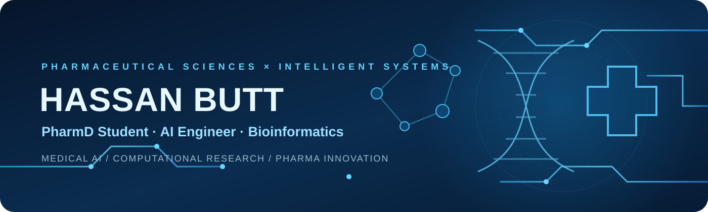

<!-- BLUE MEDICAL-TECH PROFILE · curated from the supplied CVs and LinkedIn PDF -->

  

<h1 align="center">Hassan Butt</h1>

  <strong>PharmD Student · AI Engineer · Bioinformatics Researcher</strong>

  
  
  

  

---

## 🧬 About

I'm a **Doctor of Pharmacy (PharmD) undergraduate at the University of Karachi** developing practical skills across **AI engineering, machine learning, and bioinformatics**. I’m interested in translating pharmaceutical and biomedical problems into responsible, data-driven tools.

My work spans medical-image analysis, genomics and drug-response modelling, research assistants powered by retrieval-augmented generation, and pharmaceutical quality and supply-chain prototypes. I value reproducible workflows, explainability, careful evaluation, and transparent reporting of limitations.

**Current direction:** healthcare AI · computational research · pharmaceutical Quality Assurance · Supply Chain Management.

## 🔷 The intersection

| Pharmaceutical & Biomedical Science | Artificial Intelligence & Computing | Research & Operations |
|:--|:--|:--|
| PharmD · Pharmacology · GCP awareness · GMP exposure · ICH stability principles · UV-Vis | Python · ML/DL · Computer Vision · NLP/LLMs · RAG · Agentic AI · Model Explainability | Bioinformatics · RNA-seq · GEO/TCGA · Drug-response modelling · QA documentation · FEFO · Forecasting |

## 🚀 Selected projects

  
  
  

### 🧪 PharmaVision AI — pharmaceutical inspection prototype
A modular computer-vision and interaction project exploring tablet inspection, visible PPE monitoring, gesture interaction, molecular visualisation, and voice-assisted workflows. The repository describes a **research and decision-support prototype**, not a GMP-validated inspection system.

### 📈 Banking & Healthcare Risk Prediction
An AI engineering capstone using XGBoost models for credit-default and cardiovascular-risk prediction, with threshold tuning, SHAP explainability, a Gemini explanation layer, SQLite history, and automated tests.

### 🩺 Diabetes Risk Screening App
An end-to-end educational ML application using a leakage-aware preprocessing pipeline and model comparison. The repository reports a test ROC-AUC of **0.813**; it is a screening demonstration, **not a medical diagnosis tool**.

### 🧠 Other research and builds
- **Drug-response genomics:** ML workflows using GDSC2, DepMap and TCGA data, with SHAP-based interpretation and pan-cancer analysis.
- **Brain-tumour framework:** MRI deep-learning classification combined with TCGA-GBM/LGG transcriptomic analysis.
- **Medical image AI:** Skin-lesion and fungal-image classification experiments using transfer learning and model evaluation.
- **RAG research assistant:** document-grounded question answering using Llama 3, Groq/Ollama and Streamlit.
- **ShelfSense AI:** team-led aspirin stability research, smartphone-image degradation modelling validated against UV-Vis (LOOCV R² = 0.946 in the reported pilot), and a FEFO inventory-risk dashboard.

## 🧰 Technology toolkit

  

  
  
  
  
  

## 🧫 Pharmaceutical & research experience

- **Getz Pharma — Industrial exposure:** Production, Warehouse, and Quality Control departments.
- **Alkhidmat Foundation Pakistan — Summer Social Internship:** community healthcare exposure, medication counselling, and patient interaction.
- **Dow University of Health Sciences — Blood Banking Supervised Practitioner:** training in blood grouping, component handling, and transfusion medicine.
- **ShelfSense AI — Team Lead:** led a five-member team on an ICH-referenced aspirin stability study and FEFO inventory-risk dashboard.
- **AI & Data Analytics internships (2026):** project-based remote experience with Synent Technologies, Datheon, Oasis Infobyte, Syntecxhub, Zynvex Solutions, and Progree.
- **Med NovaBridge — Ambassador:** supporting a medical and pharmacy learning community.

## 📚 Education & certifications

**Doctor of Pharmacy (PharmD)** — University of Karachi · 2023–Present

Selected training:
- AI Engineering Specialist — Analytix Camp / 365 Boot Camp
- Machine Learning — NED University
- Supply Chain Management — IIENSTITU (Europass-recognised certification)
- Agentic AI Mastery — SkillUstad
- Bioinformatics Mastery — BioSol
- Good Clinical Practice (GCP)
- Basics of Blood Banking — DUHS
- Scientific Manuscript Writing — DUHS

## 📝 Research & presentations

- Review article published in **IJPIHS (2026)**.
- Research presented at **ICPAS, DOW 12ANC, and PHARMACON (2026)**.
- First-author research manuscript in the peer-review process.

*Research metrics shown in project documentation are dataset- and experiment-specific; they should not be interpreted as clinical validation or deployment readiness.*

## 📊 GitHub activity

  
  

  

  

---

## 🤝 Let's connect

I'm interested in **AI/ML internships, computational and biomedical research collaborations, and opportunities applying data science to pharmaceutical Quality Assurance and Supply Chain Management**.

  <a href="mailto:khnbutt118@gmail.com">khnbutt118@gmail.com</a> ·
  <a href="https://www.linkedin.com/in/hassan-butt-ab0036334/">LinkedIn</a> ·
  <a href="https://hassanbuttportfolio.vercel.app/">Portfolio</a>

Pharmacy × Artificial Intelligence · Building responsibly at the intersection of healthcare and computation.

